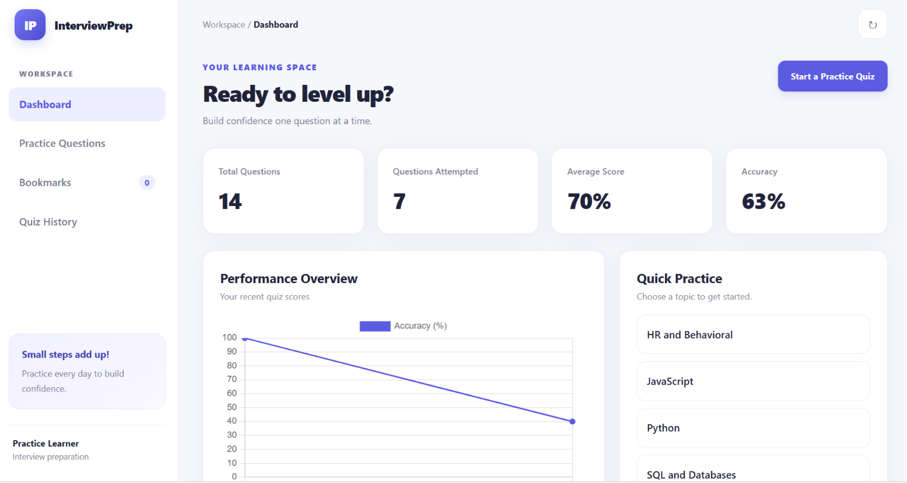
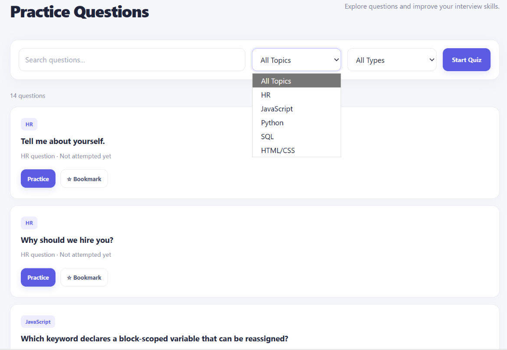
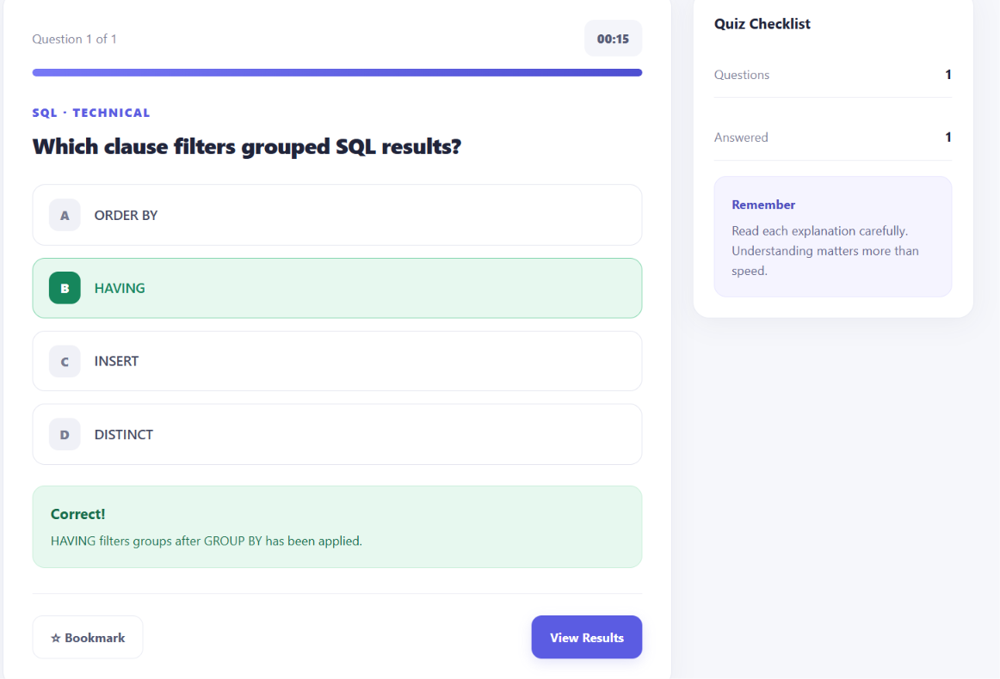
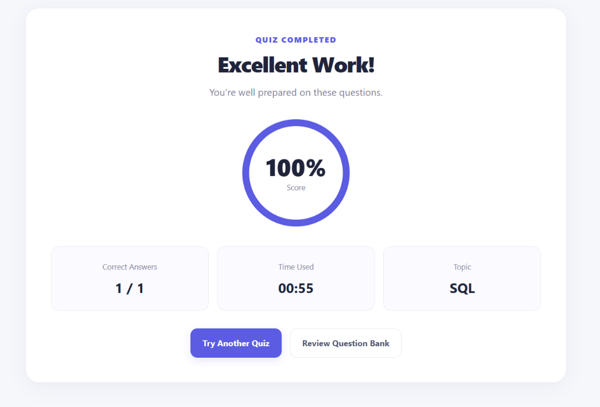
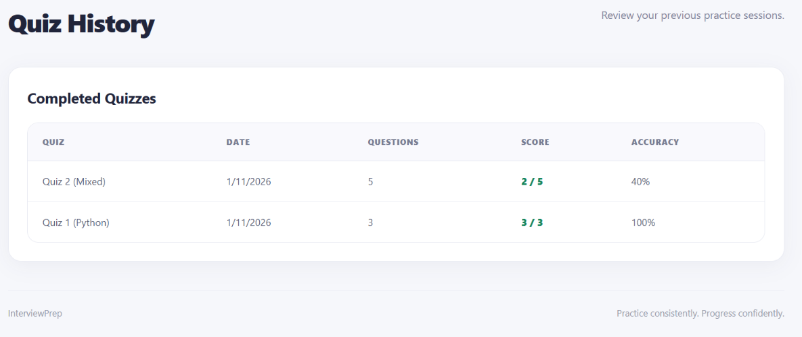

# InterviewPrep – Interview Practice Portal

A responsive web app for practicing technical and HR interview questions. Take timed quizzes, bookmark tough questions, and track your progress on a dashboard. Built with plain HTML, CSS and JavaScript, with no framework and no backend.

## Features

- **Dashboard** with total questions, attempted questions, average score and accuracy
- **Performance chart** of your recent quiz scores (Chart.js)
- **Practice Questions** page with search and topic/type filters
- **Timed quizzes** (30 seconds per question) with instant feedback and explanations
- **Topics:** HR and Behavioral, JavaScript, Python, SQL, HTML/CSS
- **Bookmarks** to save questions for later review
- **Quiz History** with date, score and accuracy for each attempt
- **Saved progress** in the browser using LocalStorage
- **Responsive layout** with a collapsible sidebar on mobile
- **Reset option** to clear all saved data

  ## Screenshots

### Dashboard
Track your total questions, attempted questions, average score and accuracy, with a chart of your recent quiz performance.



### Practice Questions
Search and filter questions by topic and type, bookmark the ones you want to revisit, or start a quiz from the filtered list.



### Quiz
Answer timed questions and get instant feedback with a short explanation after each one.



### Results
See your score, correct answers and time used at the end of every quiz.



### Quiz History
Review every completed quiz with its date, score and accuracy.



## Tech Stack

| Area | Technology |
|------|------------|
| Structure | HTML5 |
| Styling | CSS3 (Grid, Flexbox, custom properties) |
| Logic | Vanilla JavaScript (ES6+) |
| Charts | [Chart.js](https://www.chartjs.org/) via CDN |
| Storage | Browser LocalStorage |

## Getting Started

No installation or build step is needed.

```bash
# 1. Clone the repository
git clone https://github.com/<your-username>/<repo-name>.git

# 2. Open the project folder
cd <repo-name>

# 3. Open index.html in your browser
```

You can also use the **Live Server** extension in VS Code. An internet connection is needed to load Chart.js from the CDN.

## Project Structure

```
├── index.html    # Page structure and views
├── style.css     # Layout, components and responsive styles
└── script.js     # Question bank, quiz logic, storage and dashboard
```

## How It Works

1. Pick a topic from the dashboard, or filter on the Practice Questions page.
2. Select an answer and click **Check Answer**.
3. Read the explanation, then move to the next question.
4. See your results, which are saved to Quiz History and the dashboard chart.

## Adding Your Own Questions

Open `script.js` and add an object to the `questions` array:

```js
{
    id: 15,                      // must be unique
    topic: "Python",             // HR, JavaScript, Python, SQL or HTML/CSS
    type: "Technical",           // "Technical" or "HR"
    question: "Your question here?",
    options: ["Option A", "Option B", "Option C", "Option D"],
    answer: 1,                   // index of the correct option (starts at 0)
    explanation: "Why this answer is correct."
}
```

To add a new topic, also add it to the topic dropdown and the Quick Practice buttons in `index.html`.

## Future Improvements

- More questions and topics (React, Java, DSA, System Design)
- Difficulty levels
- Dark mode
- Export results
- Backend with user accounts
